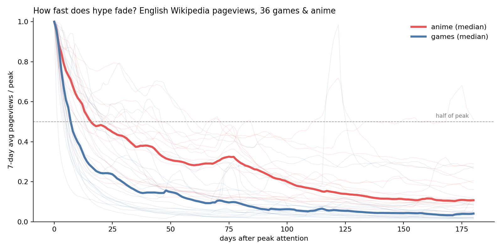
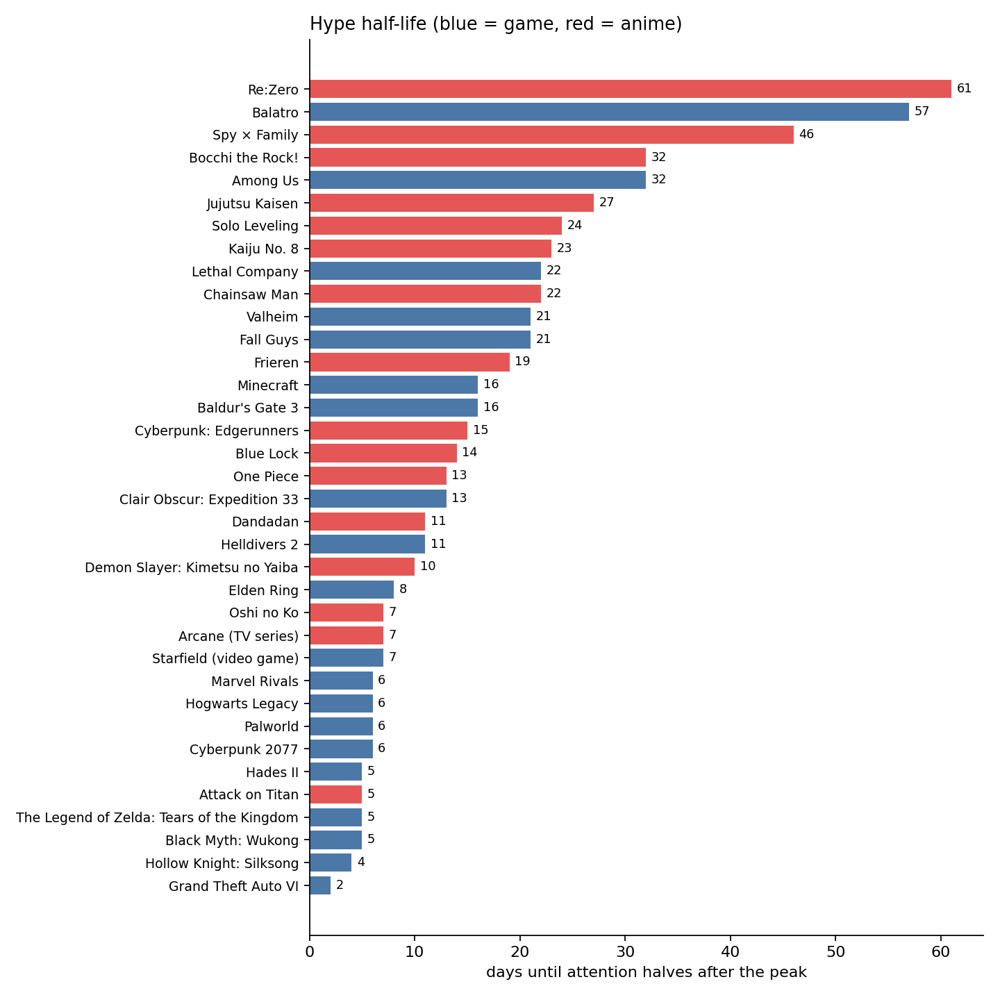
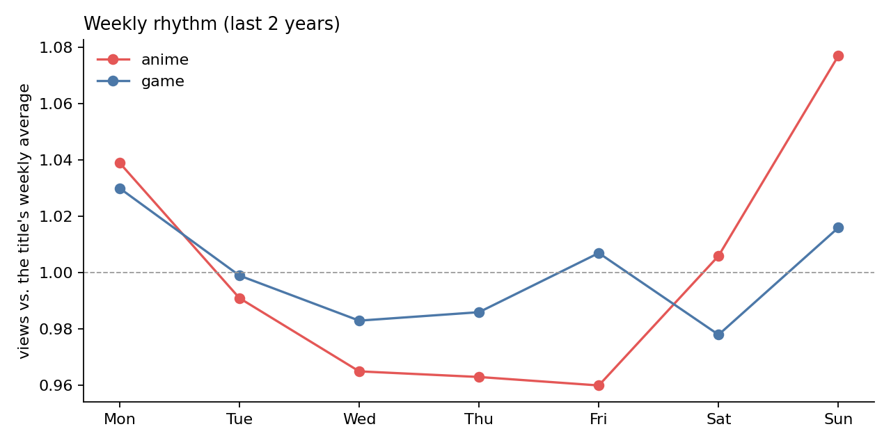

# Hype Tracker

**How fast does attention fade after a game or anime hits its peak?** A small analytics-engineering project: extract daily Wikipedia pageviews, model them in SQL with DuckDB (staging → facts → marts, window functions throughout), test the SQL, and chart the marts.



## Findings (36 hand-picked titles, English Wikipedia, Jan 2020 – Nov 2026)
| | Titles | Median half-life | Attention kept after 90 days | after 365 days |
|---|---|---|---|---|
| **Anime** | 16 | **17 days** | **24.5%** | 11.3% |
| **Games** | 20 | 7.5 days | 6.3% | 4.0% |

- **Game hype halves in about a week.** *Palworld* and *Cyberpunk 2077* lost half their peak attention in 6 days. *GTA VI*'s peak (the first trailer, Dec 2023) halved in 2 days.
- **Anime holds attention ~2× longer.** A weekly episode schedule keeps people coming back. *Spy × Family* (46 days) and *Re:Zero* (61 days) have the longest half-lives in the set.
- **The slow burners are the exceptions:** *Balatro* (57 days) and *Among Us* (32 days) grew by word of mouth rather than a launch spike.
- **Weekly rhythm:** anime pages get +8% views on Sundays, consistent with weekend episode releases (a hypothesis; the data doesn't prove the cause). Game pages are much flatter.




**Caveats.**
- The "peak" is the biggest attention event, not always the release. For GTA VI it is a trailer; for Attack on Titan, the series finale.
- 36 titles picked by hand is a small, biased sample, and English Wikipedia is not the whole internet.
- Treat these as descriptive findings, not universal laws.

## Pipeline
```
titles.csv ──► ingest.py ──► data/raw/pageviews.csv ──► DuckDB ──► marts ──► charts
               (MediaWiki API: resolve redirects;        sql/01_staging     mart_decay
                Wikimedia REST: daily pageviews,         sql/02_daily       mart_category
                rate-limit aware, retries on 429)        sql/03_peaks       mart_weekday
                                                         sql/04_decay
                                                         sql/05_summaries
```
SQL highlights:
- **Gap filling** with `generate_series` so rolling windows stay calendar-correct (`02_daily.sql`).
- **7-day rolling averages** with window frames (`ROWS BETWEEN 6 PRECEDING AND CURRENT ROW`).
- **Peak detection** with `row_number()`, **half-life** as the first day below 50% of the peak, and **retention** via conditional aggregation (`03`, `04`).
- **Weekday normalisation** against each title's own weekly mean (`05`).

The SQL is **tested**: `tests/test_sql.py` runs the real models on a synthetic series whose peak, half-life and gap-filling results are known in advance.

## Reproduce
```bash
python -m venv .venv && .venv\Scripts\activate
pip install -r requirements.txt && pip install -e .
python -m hype.ingest          # ~2 min (polite rate limit), ~80k rows
python -m hype.pipeline        # builds data/hype.duckdb, writes results/*.csv
python -m hype.plots
pytest
```
Add titles by editing `titles.csv` (category, Wikipedia article title).

## Author
Hamza Fakhri, Computer Science engineering student, Polytech Nantes.
